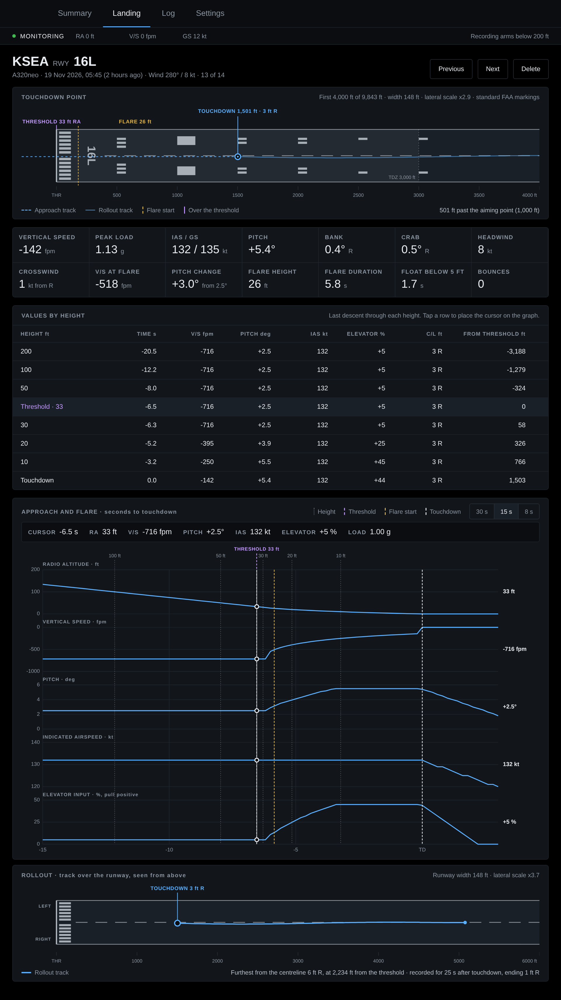
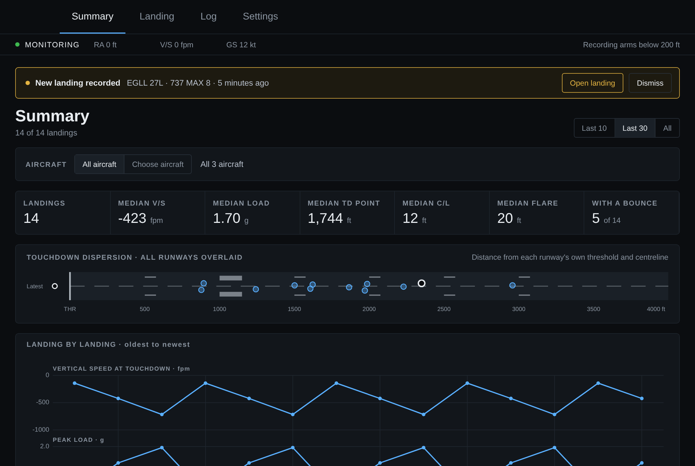
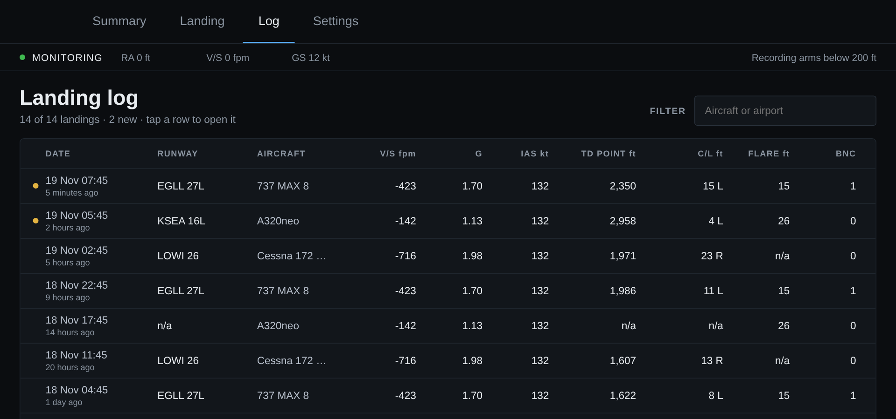

<p align="center"></p>

# Flarecord

**A landing monitor for Microsoft Flight Simulator 2024, contained entirely in the sim.**

Flarecord is an addon that runs on the in-sim tablet (EFB). It records every landing you fly and
shows exactly what happened: where you touched down, how the flare went, and what the aircraft
was doing at each height on the way in.

- **Fully in-sim.** One folder in Community. No external application to start, no connection to
  set up, nothing running beside the simulator.
- **Works in any aircraft that has the tablet.** Recording is automatic: fly the approach and
  the landing is there when you open the app.
- **Your data stays with you.** Landings are kept between sessions in plain files on your PC.
- **A measuring instrument.** It reports what happened and leaves the judgement to you: no
  grades and no coaching.



## What you get

- **Automatic recording.** Flarecord arms below 200 ft on approach and saves the landing when you
  slow down. It works in any aircraft that has the tablet.
- **Touchdown point on the runway.** A top-down runway view with your approach and rollout track,
  the flare start, the height over the threshold and the touchdown point, drawn over the
  touchdown zone and markings for that runway.
- **Values at contact.** Vertical speed, peak load, airspeed and ground speed, pitch, bank, crab,
  headwind and crosswind, flare height and duration, float time and bounces.
- **Values by height.** One row each for 200, 100, 50, 30, 20 and 10 ft, the threshold and
  touchdown, so "what were my pitch and sink rate at 50 ft" is a single glance.
- **Approach and flare chart.** Radio altitude, vertical speed, pitch, airspeed and elevator input
  stacked on one time axis. Tap anywhere to read every value at that moment.
- **Approach view.** The same landing from 3,000 ft down: the height the approach was stable
  from, which condition was met last, deviation from the glidepath and the centreline in dots,
  and engine power. It works on any runway, with or without an ILS tuned.
- **Second by second.** The five seconds either side of touchdown as a table, with which wheel
  touched first.
- **Rollout view.** Your track after touchdown over a plain runway seen from above, to show how
  far you were from the centreline and where.
- **A log that persists.** Every landing is kept between sessions, with new ones marked until you
  open them.
- **Summary across landings.** Medians, touchdown points overlaid on one runway, and a
  landing-by-landing trend, for all aircraft or the ones you tick.
- **Your units.** Feet or metres, fpm or m/s, knots or km/h.
- **Methods on show.** A "?" next to a figure explains how it was obtained, and Settings lists the
  full methodology.

## Screens

### Summary

Opens first. Figures across your last 10, last 30 or all landings, filtered by aircraft, with a
notice when a new landing is waiting.



### Log

Every landing as a table, newest first, with a filter. An amber dot marks a landing you have not
opened yet.



## Install

1. Download the latest `flarecord-landing-monitor` zip from the
   [Releases page](https://github.com/itsCongQi/flarecord-landing-analysis/releases/latest).
2. Extract it. You get one folder named `flarecord-landing-monitor`.
3. Move that folder into your MSFS 2024 Community folder. Unless you chose another location
   when installing the sim, it is here:
   - Steam: `%APPDATA%\Microsoft Flight Simulator 2024\Packages\Community`
   - Microsoft Store and Xbox app:
     `%LOCALAPPDATA%\Packages\Microsoft.Limitless_8wekyb3d8bbwe\LocalCache\Packages\Community`
4. Start the simulator and load a flight. Flarecord appears among the apps on the tablet.

The result should be `Community\flarecord-landing-monitor\manifest.json`. If there is a second
`flarecord-landing-monitor` folder inside the first, move the inner one up.

**Updating.** Delete the old `flarecord-landing-monitor` folder from Community and put the new one
in its place, with the simulator closed. Your landings are stored elsewhere and are kept.

**Removing.** Delete the folder from Community. To remove your recorded landings as well, delete
the data folder that Settings in the app shows.

Use the zip from Releases, not the green Code button: this repository is source code and does
nothing if copied into Community as it is.

## Using it

1. Fly an approach. The status strip at the top of the app shows **MONITORING**, then **ARMED**
   below 200 ft, then **RECORDING** through the rollout.
2. After you slow down, open the tablet and Flarecord. Summary shows a notice for the new landing.
3. Open the landing, tap the chart or a height row to inspect a moment, and use Previous and Next
   to step through the log.

Until your first landing the pages say that nothing is recorded yet. There is nothing to set up:
just fly.

## Good to know

- **Runway markings are derived, not read from the sim.** The simulator does not expose painted
  markings, so Flarecord draws what the standards call for on that runway: FAA rules at US
  airports and ICAO rules elsewhere, scaled to the runway. Scenery that differs will not match.
- **Runway identification comes from the sim's navigation data.** If no runway is matched, the
  landing is still recorded, without the runway views.
- **Your data is in plain files you can back up.** Landings are saved in the simulator's work
  folder for this addon, up to 500 of them, with charts for the newest 60. Settings in the app
  shows the folder and how to back it up or move it to another PC.
- **An early release.** The analysis is tested against simulated landings and the app runs in
  the sim, but it has not seen many aircraft and airports yet. If a landing is missed or a
  runway is not matched, please open an issue with the aircraft and airport.

## For developers

To build the package yourself you need the MSFS 2024 SDK and its samples. The steps are in
[`PackageSources/Flarecord/README-build.md`](PackageSources/Flarecord/README-build.md).

The analysis core is plain TypeScript with no simulator dependencies and is tested in Node:

```
npm install
npm test
```

Node 22.6 or newer is required. How things are measured, the flare detection method, storage,
and notes on the MSFS 2024 EFB platform are in [docs/TECHNICAL.md](docs/TECHNICAL.md).

## License

Flarecord is free to use, copy, change and share for noncommercial purposes under the
[PolyForm Noncommercial License 1.0.0](LICENSE). Two conditions matter most:

- **Credit the original project.** Anyone who gets a copy from you, changed or not, must also get
  the license terms and the notice lines at the top of [LICENSE](LICENSE), which name this
  project and link to it.
- **No commercial use.** It may not be sold, bundled into a paid product or used to make money.

For anything outside those terms, open an issue to ask.

## Disclaimer

Flarecord is an independent project for flight simulation only. It is not affiliated with or
endorsed by Microsoft or Asobo Studio, and it must not be used for real-world flying.
